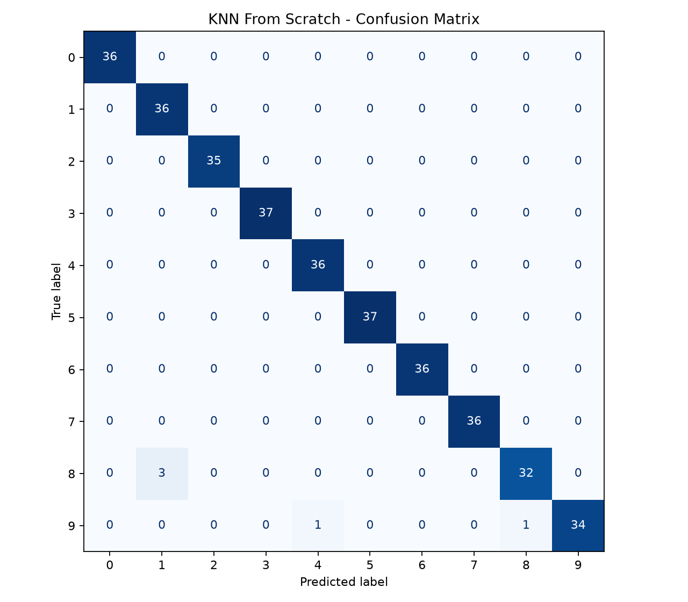
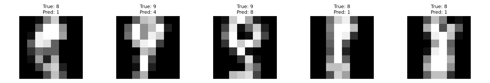

# Handwritten Digit Recognition — KNN from Scratch

A machine learning project that implements the **K-Nearest Neighbors (KNN)** algorithm from scratch using Python and NumPy to recognize handwritten digits.

The project focuses on understanding how KNN works internally, comparing a custom implementation with scikit-learn, and analyzing classification errors.

## Project Overview

Handwritten digit recognition is a classic computer vision classification problem. In this project, each handwritten digit is represented as a numerical feature vector, and KNN predicts its label based on the labels of the closest training examples.

**Project objectives:**
- Implement KNN classification logic using NumPy.
- Understand how images are represented as numerical features.
- Compare a custom KNN implementation against scikit-learn's KNN classifier.
- Evaluate classification performance and investigate incorrect predictions.

## Dataset

This project uses the **Digits dataset** provided by scikit-learn.

| Property | Description |
|---|---|
| Total samples | 1,797 |
| Image resolution | 8 × 8 pixels |
| Features per image | 64 |
| Classes | Digits 0–9 |
| Training split | 80% |
| Testing split | 20% |

Each image is flattened from an 8 × 8 pixel matrix into a 64-dimensional feature vector.

The dataset is split using `train_test_split` with `random_state=42` and stratification to preserve the class distribution.

## Methodology

### 1. Data Preparation

The Digits dataset is loaded using scikit-learn. Image data and target labels are separated into feature and label arrays.

The dataset is divided into:
- **Training set:** 1,437 samples
- **Testing set:** 360 samples

### 2. KNN Implementation from Scratch

The custom KNN classifier uses the following steps:

1. Store the training feature vectors and their corresponding labels.
2. Calculate Euclidean distances between each test sample and the training samples.
3. Identify the three nearest neighbors (`k=3`).
4. Predict the digit using majority voting among the neighbors.

Euclidean distance is calculated as:

\[
d(x,y)=\sqrt{\sum_{i=1}^{64}(x_i-y_i)^2}
\]

This approach uses pixel intensities directly as numerical features.

### 3. Model Comparison

The custom KNN implementation is compared with `KNeighborsClassifier` from scikit-learn using the same dataset split and number of neighbors.

Prediction agreement is calculated to verify whether both implementations produce identical predictions on the test set.

### 4. Evaluation

Model performance is evaluated using:
- Classification accuracy
- Confusion matrix
- Misclassified image visualization
- Prediction agreement with scikit-learn

## Results

| Metric | Result |
|---|---|
| Custom KNN accuracy | **98.61%** |
| Scikit-learn KNN accuracy | **98.61%** |
| Prediction agreement | **100.00%** |
| Correct predictions | 355 / 360 |
| Incorrect predictions | 5 / 360 |

The custom implementation achieved the same test accuracy and predictions as scikit-learn's KNN classifier under the tested configuration.

### Confusion Matrix



The confusion matrix shows that most digits were classified correctly. The five incorrect predictions were concentrated in a small number of digit pairs.

### Misclassified Examples



The incorrect predictions included:

| Actual Digit | Predicted Digit | Count |
|---|---|---|
| 8 | 1 | 3 |
| 9 | 4 | 1 |
| 9 | 8 | 1 |

## Error Analysis

The most frequent classification error was predicting the digit **8 as 1**.

Visual inspection suggests that some handwritten digits are difficult to distinguish at the dataset's low image resolution of 8 × 8 pixels.

KNN with Euclidean distance compares pixel intensities at corresponding positions. Consequently, differences in stroke position, shape, and thickness can influence which training samples are considered nearest neighbors.

These factors are possible explanations for the observed errors, but additional experiments would be needed to establish their individual effects.

## Project Structure

```text
Handwritten-Digit-Recognition/
├── main.py
├── requirements.txt
├── README.md
└── results/
    ├── confusion_matrix.png
    └── wrong_predictions.png
```

## How to Run

**1. Clone the repository**

```bash
git clone https://github.com/TheToontang/Handwritten-Digit-Recognition
cd Handwritten-Digit-Recognition
```

**2. Install dependencies**

```bash
pip install -r requirements.txt
```

**3. Run the project**

```bash
python main.py
```

The program prints the evaluation results and saves visualizations to the `results/` directory.

## Key Learnings

Through this project, I gained practical experience in:

- Representing grayscale images as numerical feature vectors.
- Implementing KNN classification logic using NumPy.
- Understanding Euclidean distance and majority voting.
- Preparing reproducible training and testing splits.
- Validating a custom implementation against a standard machine learning library.
- Investigating classification errors through visual analysis.

## Limitations and Future Work

This project currently evaluates KNN using the scikit-learn Digits dataset.

Potential extensions include:

- Testing different values of `k` and distance metrics.
- Evaluating handwritten digits collected from new participants.
- Investigating generalization to previously unseen writers.
- Comparing KNN with neural network-based approaches.

**Note:** Writer-based generalization and custom handwriting collection are future extensions and are not included in the current experimental results.

## Technologies Used

Python · NumPy · scikit-learn · Matplotlib